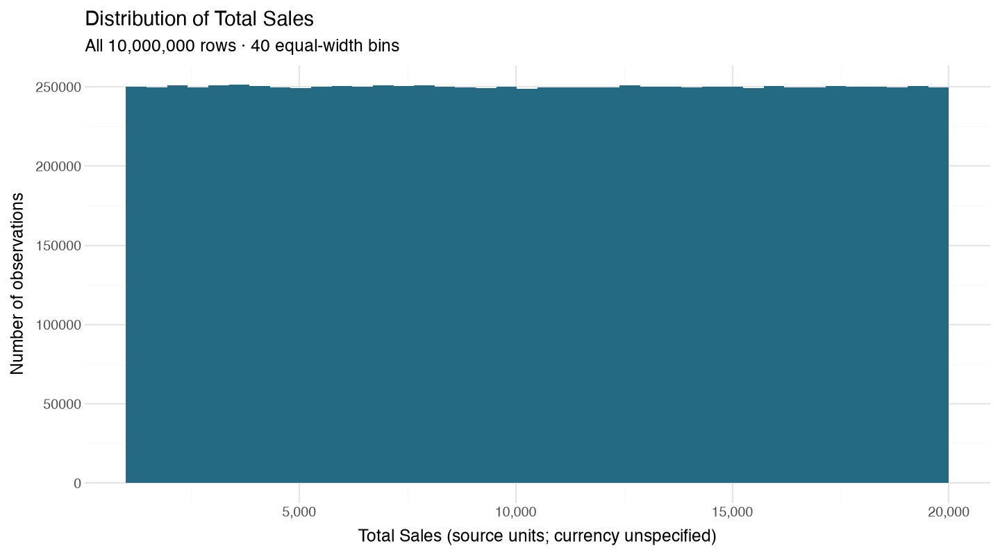

# Brewery sales exploration

Source: `brewery_sales_cleaned.csv`. All 10,000,000 rows and 20 columns inspected.

Full CSV scan; exact quantiles; sample SD (ddof=1); pandas adjusted skewness and excess kurtosis; Pearson correlations.

## Prior preprocessing

The supplied reports retain all 10 million rows, parse dates/numeric values, and report no missing values or exact duplicate rows. No imputation, capping, row deletion, or category collapsing was performed. The 160 million conversion count refers to field values, not distinct rows. Sales definition and sentinel meanings remain unresolved. The validation JSON claims unique Batch_IDs, but the existing validation code hardcodes that claim and the cleaning code checks whole-row duplicates, so ID uniqueness is not independently established here.

## Variables and missingness

| variable | dtype | missing |
| --- | --- | --- |
| Batch_ID | int64 | 0 |
| Brew_Date | str | 0 |
| Beer_Style | str | 0 |
| SKU | str | 0 |
| Location | str | 0 |
| Fermentation_Time | int64 | 0 |
| Temperature | float64 | 0 |
| pH_Level | float64 | 0 |
| Gravity | float64 | 0 |
| Alcohol_Content | float64 | 0 |
| Bitterness | int64 | 0 |
| Color | int64 | 0 |
| Ingredient_Ratio | str | 0 |
| Volume_Produced | int64 | 0 |
| Total_Sales | float64 | 0 |
| Quality_Score | float64 | 0 |
| Brewhouse_Efficiency | float64 | 0 |
| Loss_During_Brewing | float64 | 0 |
| Loss_During_Fermentation | float64 | 0 |
| Loss_During_Bottling_Kegging | float64 | 0 |

Brew_Date is read as text from CSV; prior date parsing is documented in the cleaning report. CSV does not preserve native date types.

## Descriptive statistics

| variable | count | mean | std | min | 1% | 25% | 50% | 75% | 99% | max |
| --- | --- | --- | --- | --- | --- | --- | --- | --- | --- | --- |
| Total_Sales | 10000000.0 | 10497.785344 | 5485.995545 | 1000.000963 | 1189.697005 | 5747.243543 | 10496.29135 | 15249.212799 | 19810.207523 | 19999.999641 |
| Alcohol_Content | 10000000.0 | 5.249709 | 0.432961 | 4.5 | 4.51497 | 4.874663 | 5.249849 | 5.624602 | 5.98501 | 6.0 |
| Quality_Score | 10000000.0 | 7.999825 | 1.154679 | 6.000001 | 6.039954 | 6.999507 | 7.999932 | 8.999796 | 9.960011 | 9.999999 |
| Fermentation_Time | 10000000.0 | 14.500898 | 2.872006 | 10.0 | 10.0 | 12.0 | 15.0 | 17.0 | 19.0 | 19.0 |

## Beer_Style frequencies

| Beer_Style | count | percent |
| --- | --- | --- |
| Ale | 1251002 | 12.51 |
| IPA | 1249603 | 12.496 |
| Lager | 1249570 | 12.4957 |
| Pilsner | 1249426 | 12.4943 |
| Porter | 1250773 | 12.5077 |
| Sour | 1250307 | 12.5031 |
| Stout | 1250296 | 12.503 |
| Wheat Beer | 1249023 | 12.4902 |

## SKU frequencies

| SKU | count | percent |
| --- | --- | --- |
| Bottles | 2501597 | 25.016 |
| Cans | 2498777 | 24.9878 |
| Kegs | 2498753 | 24.9875 |
| Pints | 2500873 | 25.0087 |

## Location frequencies

| Location | count | percent |
| --- | --- | --- |
| Electronic City | 999307 | 9.9931 |
| HSR Layout | 1000789 | 10.0079 |
| Indiranagar | 999887 | 9.9989 |
| Jayanagar | 1000760 | 10.0076 |
| Koramangala | 1000220 | 10.0022 |
| Malleswaram | 999629 | 9.9963 |
| Marathahalli | 1000164 | 10.0016 |
| Rajajinagar | 1000147 | 10.0015 |
| Whitefield | 999279 | 9.9928 |
| Yelahanka | 999818 | 9.9982 |

## Total Sales distribution

| index | value |
| --- | --- |
| skewness | 0.000685 |
| excess_kurtosis | -1.20062 |
| lower_1.5_IQR_fence | -8505.710341 |
| upper_1.5_IQR_fence | 29502.166683 |
| below_lower_fence | 0.0 |
| above_upper_fence | 0.0 |
| nonpositive_sales | 0.0 |
| sales_sum | 104977853439.40274 |

### Five lowest sales observations

| index | Batch_ID | Total_Sales |
| --- | --- | --- |
| 0 | 2884629 | 1000.0009630942444 |
| 1 | 4024518 | 1000.0015505210448 |
| 2 | 8776910 | 1000.001827482702 |
| 3 | 6943988 | 1000.0082274563838 |
| 4 | 2447695 | 1000.0103092322552 |

### Five highest sales observations

| index | Batch_ID | Total_Sales |
| --- | --- | --- |
| 0 | 5254961 | 19999.99964105241 |
| 1 | 3934700 | 19999.998336476536 |
| 2 | 7422612 | 19999.997394563467 |
| 3 | 9798808 | 19999.994702125103 |
| 4 | 1926159 | 19999.99039246004 |

These are observed endpoints, not automatically errors or influential observations. The 1.5-IQR rule describes marginal sales extremes; regression influence cannot be assessed before fitting a model.

## Continuous predictor correlations

| predictor | Alcohol_Content | Quality_Score | Fermentation_Time |
| --- | --- | --- | --- |
| Alcohol_Content | 1.0 | 6.9e-05 | 0.000124 |
| Quality_Score | 6.9e-05 | 1.0 | -4.1e-05 |
| Fermentation_Time | 0.000124 | -4.1e-05 | 1.0 |

Only the three proposed continuous predictors are included. Pairwise correlations do not establish absence of multicollinearity involving categorical encodings or future interaction terms. No auxiliary regressions or VIF models were fitted.

## Proposed model availability

All required variables available: True. Complete rows across outcome and six predictors: 10,000,000. Outcome: Total_Sales. Categorical predictors: Beer_Style, SKU, Location. Numeric predictors: Alcohol_Content, Quality_Score, Fermentation_Time.

## Scope

No dataset writes, preprocessing, new model features, or regression estimation. Summary tables and histogram bins are descriptive outputs only. Existing instructions and preprocessing reports were not changed.

## Findings and decisions before modeling

Total Sales is approximately uniform across its observed range, with skewness 0.000685 and excess kurtosis -1.200620. There are no nonpositive sales or observations beyond the 1.5-IQR fences. The endpoint observations alone provide no reason to remove or cap records. The three proposed numeric predictors have negligible pairwise Pearson correlations (maximum absolute correlation 0.000124), so this check gives no indication of pairwise linear multicollinearity.

1. Confirm data provenance and measurement definitions. The flat sales distribution and nearly equal category frequencies are compatible with synthetic generation, but do not prove it. Confirm whether sales are observed or simulated, their currency and reporting period, alcohol and fermentation units, and how quality is scored.
2. Confirm what one row represents and whether observations are independent across batches, locations, and time. The existing code does not substantiate the validation report's separate Batch_ID uniqueness claim. Decide whether temporal or grouped dependence needs to be addressed later.
3. Choose meaningful reference levels for Beer_Style, SKU, and Location. Treat these as nominal categories, using k-1 indicator columns with an intercept at the modeling stage. Fermentation_Time has integer values from 10 to 19; decide whether a linear per-unit effect is substantively appropriate.
4. Start by considering sales in its original units. The marginal distribution gives no skewness-based reason for a log transformation. Regression assumptions concern conditional errors; assess residual shape, linearity, variance, and influence after fitting.
5. Decide whether production volume or time should be controls based on the research question. Volume_Produced and Brew_Date are available but are not part of the six proposed predictors. Do not add controls automatically or treat associations as causal effects.
6. Prespecify a small set of motivated interactions, such as Beer_Style by SKU or Beer_Style by Quality_Score. Retain their main effects and consider centering numeric predictors when implementing interactions. Check category combinations and the full design matrix for collinearity at that stage; marginal frequencies do not establish joint-cell support.
7. With 10 million observations, prioritize effect sizes, uncertainty, and practical business relevance over p-values alone. Agree on what constitutes a meaningful sales difference before modeling.
