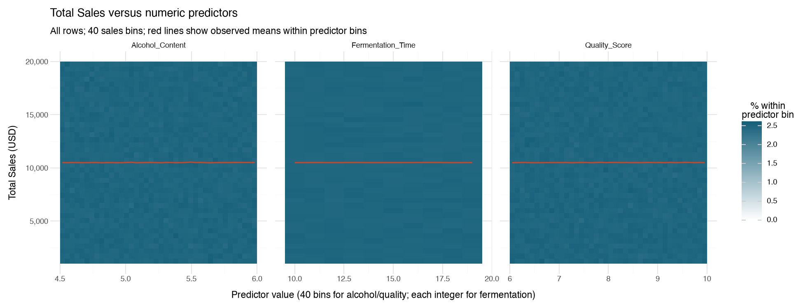
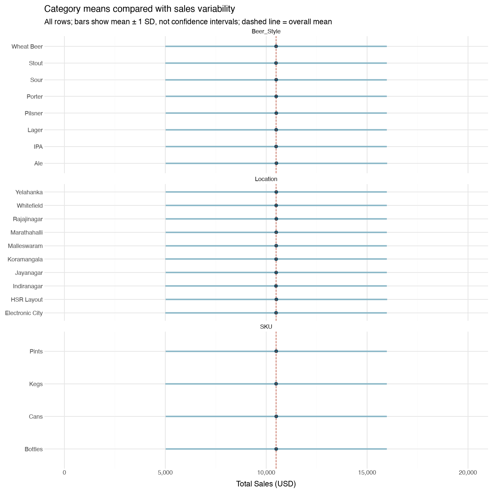
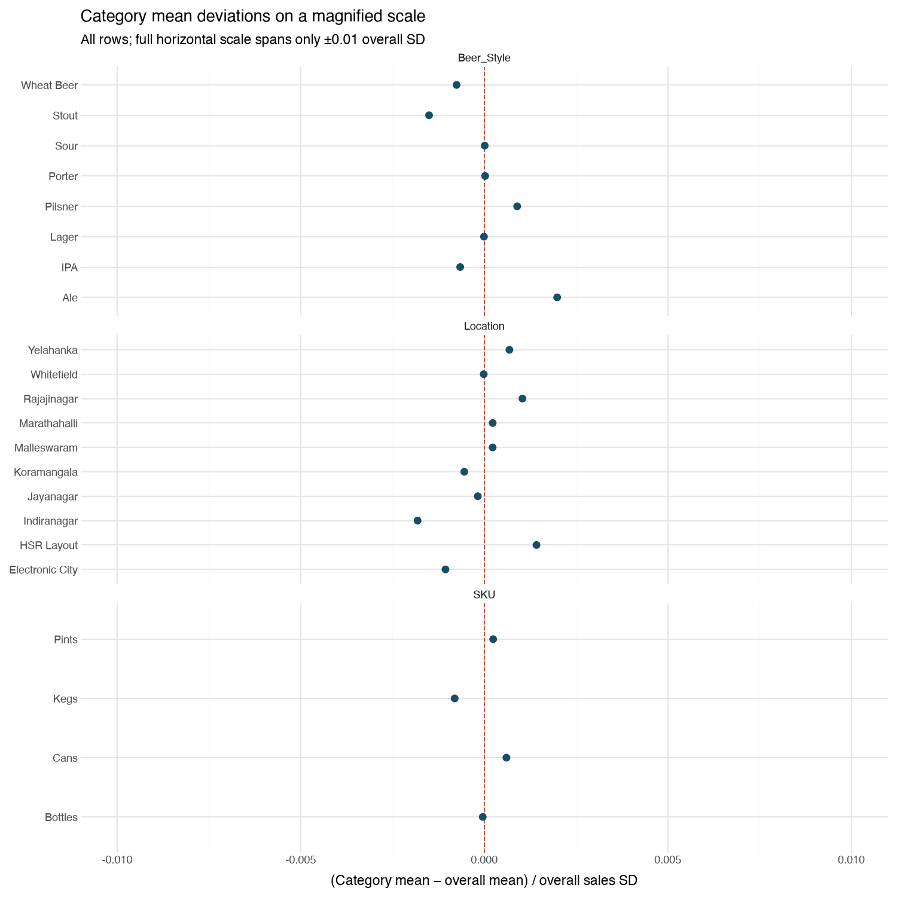

# Sales relationships: full-data exploration

All 10,000,000 rows analyzed. Overall mean sales: $10,497.785344; sample SD: $5,485.995545.

## Method

A single CSV pass reads eight columns in chunks of 250,000 rows. Centered cross-products provide Pearson correlations; grouped counts, sums, and squared sums provide means and sample SDs (ddof=1). Only the current chunk, small summary tables/histograms, and a roughly 10 MB exact ID presence array are retained. No samples, regression models, preprocessing, or row-level features are used. Plot bins and standardized group differences are descriptive summaries, not model features.

## Correlations with Total Sales

| predictor | Pearson_r | count |
| --- | --- | --- |
| Alcohol_Content | 0.00052251 | 10000000 |
| Quality_Score | 0.000516941 | 10000000 |
| Fermentation_Time | 0.000170253 | 10000000 |

## Category gaps relative to overall sales variation

| predictor | lowest_mean_category | highest_mean_category | max_mean_gap_USD | gap_divided_by_overall_SD | gap_as_percent_of_overall_SD |
| --- | --- | --- | --- | --- | --- |
| Beer_Style | Stout | Ale | 19.145662 | 0.00349 | 0.348992 |
| SKU | Kegs | Cans | 7.73228 | 0.001409 | 0.140946 |
| Location | Indiranagar | HSR Layout | 17.77151 | 0.003239 | 0.323943 |

## Sales by Beer_Style

| category | count | mean | std | difference_from_overall | difference_in_overall_SD |
| --- | --- | --- | --- | --- | --- |
| Ale | 1251002 | 10508.682409 | 5484.547223 | 10.897065 | 0.001986 |
| IPA | 1249603 | 10494.188318 | 5483.339237 | -3.597026 | -0.000656 |
| Lager | 1249570 | 10497.743533 | 5483.965878 | -0.041811 | -8e-06 |
| Pilsner | 1249426 | 10502.702867 | 5485.285641 | 4.917523 | 0.000896 |
| Porter | 1250773 | 10497.917709 | 5485.340241 | 0.132365 | 2.4e-05 |
| Sour | 1250307 | 10497.85522 | 5489.061289 | 0.069876 | 1.3e-05 |
| Stout | 1250296 | 10489.536747 | 5490.01411 | -8.248597 | -0.001504 |
| Wheat Beer | 1249023 | 10493.646935 | 5486.398792 | -4.138409 | -0.000754 |

## Sales by SKU

| category | count | mean | std | difference_from_overall | difference_in_overall_SD |
| --- | --- | --- | --- | --- | --- |
| Bottles | 2501597 | 10497.559772 | 5486.459422 | -0.225572 | -4.1e-05 |
| Cans | 2498777 | 10501.097067 | 5486.511255 | 3.311723 | 0.000604 |
| Kegs | 2498753 | 10493.364787 | 5484.821433 | -4.420557 | -0.000806 |
| Pints | 2500873 | 10499.118843 | 5486.189545 | 1.333499 | 0.000243 |

## Sales by Location

| category | count | mean | std | difference_from_overall | difference_in_overall_SD |
| --- | --- | --- | --- | --- | --- |
| Electronic City | 999307 | 10491.990579 | 5488.472558 | -5.794765 | -0.001056 |
| HSR Layout | 1000789 | 10505.589071 | 5488.346992 | 7.803727 | 0.001422 |
| Indiranagar | 999887 | 10487.817561 | 5487.495888 | -9.967783 | -0.001817 |
| Jayanagar | 1000760 | 10496.817764 | 5484.154073 | -0.96758 | -0.000176 |
| Koramangala | 1000220 | 10494.802221 | 5485.962699 | -2.983123 | -0.000544 |
| Malleswaram | 999629 | 10499.038991 | 5487.4942 | 1.253647 | 0.000229 |
| Marathahalli | 1000164 | 10499.042238 | 5486.025982 | 1.256894 | 0.000229 |
| Rajajinagar | 1000147 | 10503.494087 | 5485.869474 | 5.708743 | 0.001041 |
| Whitefield | 999279 | 10497.706374 | 5483.069524 | -0.07897 | -1.4e-05 |
| Yelahanka | 999818 | 10501.544694 | 5483.061652 | 3.75935 | 0.000685 |

## Batch_ID uniqueness

| index | value |
| --- | --- |
| rows | 10000000 |
| distinct_Batch_ID | 10000000 |
| duplicate_occurrences_after_first | 0 |
| missing_Batch_ID | 0 |
| minimum | 0 |
| maximum | 9999999 |
| unique | True |
| method | Exact presence array; within-chunk unique IDs and cross-chunk repeats counted; every ID type/range checked. |

This independently resolves the earlier unverified uniqueness claim; it does not by itself establish statistical independence of rows.

## Plots

The numeric plots aggregate every observation into two-dimensional bins. Color represents the conditional sales distribution within each predictor bin. The line is an observed bin mean, not a fitted regression. SD bars show individual sales variation, not uncertainty around category means. The separate magnified plot makes tiny differences visible without presenting them as large effects.

## Documentation review

Documentation reviewed for the sales relationship extension on November 20, 2026.

- The local `README.md` describes setup and execution, but provides no generation algorithm. The two preprocessing reports identify the Hugging Face source and describe cleaning, not the original generation process.
- The [source dataset card / rendered README](https://huggingface.co/datasets/ankurnapa/Brewery_sales) explicitly states that the dataset is synthetic and intended for educational, analytical, and simulation use. It describes sales in USD, Bangalore locations, and one batch per row. This resolves the earlier uncertainty about synthetic provenance and currency. The card provides no sales-generation equation or random seed.
- The [repository file listing](https://huggingface.co/datasets/ankurnapa/Brewery_sales/tree/main), at the displayed commit `dcc498f`, lists `.gitattributes`, `README.md`, and `brewery_data_complete_extended.csv`; no generator script is listed. The card flags missing/empty YAML metadata. Viewer metadata lists 10 million rows, 20 fields, and sales values approximately 1,000–20,000. Schema/range metadata does not establish generation logic.
- In [the creator's article](https://www.linkedin.com/pulse/from-brewer-data-scientist-bridging-gaps-synthetic-ankur-napa-xumcc), dated November 24, 2023, Ankur Napa describes generating synthetic brewery data using Python randomization within realistic ranges. The article links to the creator's [Kaggle dataset](https://www.kaggle.com/datasets/ankurnapa/brewery-operations-and-market-analysis-dataset). It does not identify the sales distribution, its dependencies, a formula, or a seed. The Kaggle page and raw README/API endpoints could not be retrieved in this review; the README content was reviewed through the rendered Hugging Face card.

**Confirmed:** synthetic provenance, sales described as USD, and the creator's broad use of randomization. **Not established:** that `Total_Sales` was specifically drawn from `Uniform(1000, 20000)` independently of all other columns. The observed pattern may support that hypothesis, but does not prove the generating algorithm. The listed suggested applications are not evidence that meaningful predictor–sales relationships were built into the data.

## Interpretation and research decisions

The marginal correlations and group mean differences are negligible relative to individual sales variability. These checks provide no evidence of practically substantial marginal associations for the six proposed predictors. A business threshold has not been specified, and marginal checks do not rule out conditional, nonlinear, or interaction effects. No such models have been fitted.

Synthetic provenance is confirmed, but an independent uniform sales generator is an inference consistent with the results, not a documented algorithm. Do not claim that any beer style, packaging format, location, or production trait drives real brewery sales from these data. Agree with the group/instructor whether to use this dataset as a methods exercise demonstrating weak signal, or select observed data suitable for the original substantive question. If retaining it, state its synthetic nature, prespecify effects and interactions, and prioritize effect magnitude over significance with 10 million rows. Do not search many interactions simply to obtain significant results.

## Verification

All category counts and weighted means reconcile to the full-data totals. Every numeric plot includes all rows. Overall SD agrees with the initial exploration. Exact duplicate occurrences reconcile with rows minus distinct IDs. Input file size and modification time are unchanged. Existing instructions, cleaned data, and preprocessing reports were not overwritten.
